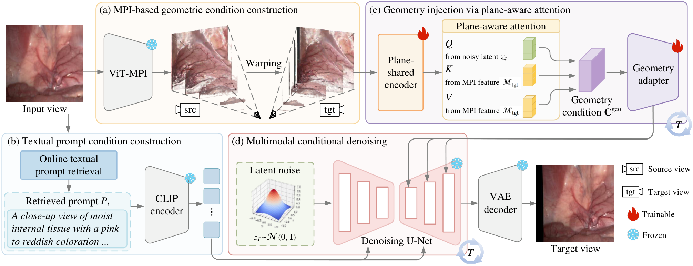

# EndoDiff

### Geometry-Language Diffusion for Monocular-to-Stereo Endoscopic View Synthesis

## Overview

EndoDiff is a geometry- and language-guided diffusion framework for monocular-to-stereo endoscopic view synthesis. Given a monocular endoscopic image, it combines geometric conditions derived from warped multi-plane images (MPIs) with retrieved textual prompts to guide target-view generation. Plane-aware attention injects geometric information into the diffusion model, while language guidance provides complementary semantic context during denoising.

## Method Overview

**Figure 1.** Overview of the EndoDiff framework, combining MPI-based geometry, retrieved textual prompts, and plane-aware attention for conditional diffusion.
